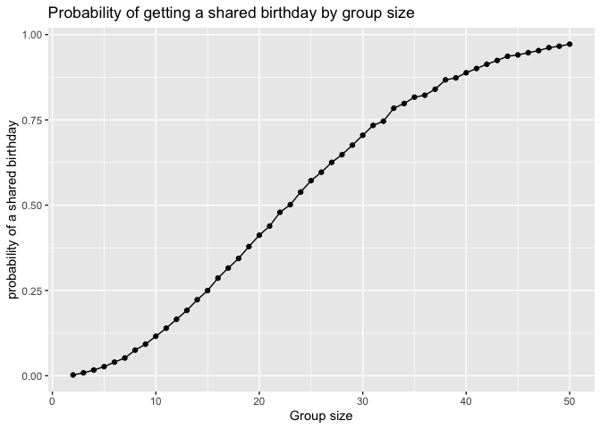
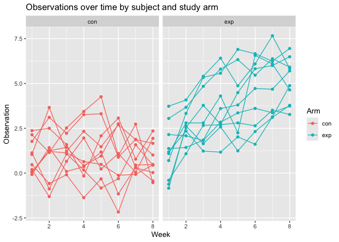
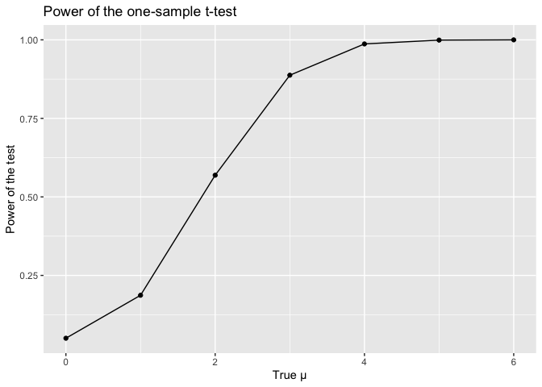
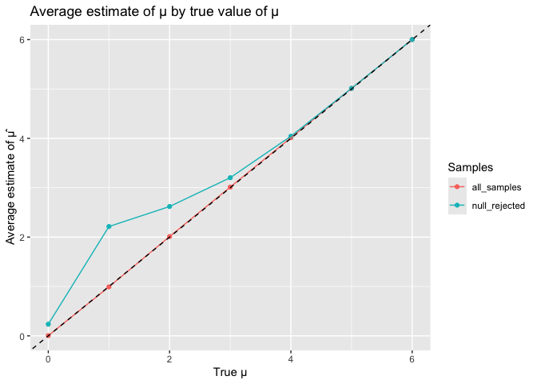

p8105_hw5_sm5975
================
Sania Sheifuddin
2026-11-17

``` r
library (tidyverse)
```

    ## ── Attaching core tidyverse packages ──────────────────────── tidyverse 2.0.0 ──
    ## ✔ dplyr     1.2.1     ✔ readr     2.2.0
    ## ✔ forcats   1.0.1     ✔ stringr   1.6.0
    ## ✔ ggplot2   4.0.3     ✔ tibble    3.3.1
    ## ✔ lubridate 1.9.5     ✔ tidyr     1.3.2
    ## ✔ purrr     1.2.2     
    ## ── Conflicts ────────────────────────────────────────── tidyverse_conflicts() ──
    ## ✖ dplyr::filter() masks stats::filter()
    ## ✖ dplyr::lag()    masks stats::lag()
    ## ℹ Use the conflicted package (<http://conflicted.r-lib.org/>) to force all conflicts to become errors

``` r
set.seed(1)
```

## Problem 1

``` r
same_birthday = function(n_room) {
  birthdays = sample (1:365, n_room, replace = TRUE)
  repeated_birthday = length(unique(birthdays)) <n_room
  repeated_birthday
}
```

``` r
same_birthday_result = 
  expand_grid(birthdays = 2:50,
              iter = 1:10000
              ) |> 
  mutate(
    result = map_lgl (birthdays, same_birthday)
  ) |> 
  
  group_by (birthdays) |> 
  summarize(
    prob_repeat = mean(result)
  )
```

``` r
same_birthday_result |> 
  ggplot(aes(x=birthdays, y = prob_repeat)) +
  geom_point () +
  geom_line () +
  labs (
    title = "Probability of getting a shared birthday by group size",
    x = "Group size",
    y = "probability of a shared birthday"
  )
```

<!-- --> The
probability that at least two people share a birthday increases as the
group size increases. the probability is small for smaller groups (at
about 0.13 at 10 people). It proceeds to increase steeply to about 35
people abouve 0.60 at around 30 people. Following this it starts
leveling a bit with an increase in group size. Even though there are 365
possible birthday only a group of 23 has better odds of having a shared
birthday. In a non-graphical situation the probabilities are probably
more higher since birthdays aren’t spread evenly accross the year.

## Problem 2

``` r
full_df = 
  tibble(
    files = unzip("./data/hw5_data.zip", list = TRUE)$Name
  ) |> 
  filter(str_detect(files, "^data/(con|exp)_\\d+\\.csv$")) |> 
  mutate(data = map(files, \(x) read_csv(unz("./data/hw5_data.zip", x)))) |> 
  unnest(data) |> 
  mutate(files = str_remove(files, "data/"))
```

    ## Rows: 1 Columns: 8
    ## ── Column specification ────────────────────────────────────────────────────────
    ## Delimiter: ","
    ## dbl (8): week_1, week_2, week_3, week_4, week_5, week_6, week_7, week_8
    ## 
    ## ℹ Use `spec()` to retrieve the full column specification for this data.
    ## ℹ Specify the column types or set `show_col_types = FALSE` to quiet this message.
    ## Rows: 1 Columns: 8
    ## ── Column specification ────────────────────────────────────────────────────────
    ## Delimiter: ","
    ## dbl (8): week_1, week_2, week_3, week_4, week_5, week_6, week_7, week_8
    ## 
    ## ℹ Use `spec()` to retrieve the full column specification for this data.
    ## ℹ Specify the column types or set `show_col_types = FALSE` to quiet this message.
    ## Rows: 1 Columns: 8
    ## ── Column specification ────────────────────────────────────────────────────────
    ## Delimiter: ","
    ## dbl (8): week_1, week_2, week_3, week_4, week_5, week_6, week_7, week_8
    ## 
    ## ℹ Use `spec()` to retrieve the full column specification for this data.
    ## ℹ Specify the column types or set `show_col_types = FALSE` to quiet this message.
    ## Rows: 1 Columns: 8
    ## ── Column specification ────────────────────────────────────────────────────────
    ## Delimiter: ","
    ## dbl (8): week_1, week_2, week_3, week_4, week_5, week_6, week_7, week_8
    ## 
    ## ℹ Use `spec()` to retrieve the full column specification for this data.
    ## ℹ Specify the column types or set `show_col_types = FALSE` to quiet this message.
    ## Rows: 1 Columns: 8
    ## ── Column specification ────────────────────────────────────────────────────────
    ## Delimiter: ","
    ## dbl (8): week_1, week_2, week_3, week_4, week_5, week_6, week_7, week_8
    ## 
    ## ℹ Use `spec()` to retrieve the full column specification for this data.
    ## ℹ Specify the column types or set `show_col_types = FALSE` to quiet this message.
    ## Rows: 1 Columns: 8
    ## ── Column specification ────────────────────────────────────────────────────────
    ## Delimiter: ","
    ## dbl (8): week_1, week_2, week_3, week_4, week_5, week_6, week_7, week_8
    ## 
    ## ℹ Use `spec()` to retrieve the full column specification for this data.
    ## ℹ Specify the column types or set `show_col_types = FALSE` to quiet this message.
    ## Rows: 1 Columns: 8
    ## ── Column specification ────────────────────────────────────────────────────────
    ## Delimiter: ","
    ## dbl (8): week_1, week_2, week_3, week_4, week_5, week_6, week_7, week_8
    ## 
    ## ℹ Use `spec()` to retrieve the full column specification for this data.
    ## ℹ Specify the column types or set `show_col_types = FALSE` to quiet this message.
    ## Rows: 1 Columns: 8
    ## ── Column specification ────────────────────────────────────────────────────────
    ## Delimiter: ","
    ## dbl (8): week_1, week_2, week_3, week_4, week_5, week_6, week_7, week_8
    ## 
    ## ℹ Use `spec()` to retrieve the full column specification for this data.
    ## ℹ Specify the column types or set `show_col_types = FALSE` to quiet this message.
    ## Rows: 1 Columns: 8
    ## ── Column specification ────────────────────────────────────────────────────────
    ## Delimiter: ","
    ## dbl (8): week_1, week_2, week_3, week_4, week_5, week_6, week_7, week_8
    ## 
    ## ℹ Use `spec()` to retrieve the full column specification for this data.
    ## ℹ Specify the column types or set `show_col_types = FALSE` to quiet this message.
    ## Rows: 1 Columns: 8
    ## ── Column specification ────────────────────────────────────────────────────────
    ## Delimiter: ","
    ## dbl (8): week_1, week_2, week_3, week_4, week_5, week_6, week_7, week_8
    ## 
    ## ℹ Use `spec()` to retrieve the full column specification for this data.
    ## ℹ Specify the column types or set `show_col_types = FALSE` to quiet this message.
    ## Rows: 1 Columns: 8
    ## ── Column specification ────────────────────────────────────────────────────────
    ## Delimiter: ","
    ## dbl (8): week_1, week_2, week_3, week_4, week_5, week_6, week_7, week_8
    ## 
    ## ℹ Use `spec()` to retrieve the full column specification for this data.
    ## ℹ Specify the column types or set `show_col_types = FALSE` to quiet this message.
    ## Rows: 1 Columns: 8
    ## ── Column specification ────────────────────────────────────────────────────────
    ## Delimiter: ","
    ## dbl (8): week_1, week_2, week_3, week_4, week_5, week_6, week_7, week_8
    ## 
    ## ℹ Use `spec()` to retrieve the full column specification for this data.
    ## ℹ Specify the column types or set `show_col_types = FALSE` to quiet this message.
    ## Rows: 1 Columns: 8
    ## ── Column specification ────────────────────────────────────────────────────────
    ## Delimiter: ","
    ## dbl (8): week_1, week_2, week_3, week_4, week_5, week_6, week_7, week_8
    ## 
    ## ℹ Use `spec()` to retrieve the full column specification for this data.
    ## ℹ Specify the column types or set `show_col_types = FALSE` to quiet this message.
    ## Rows: 1 Columns: 8
    ## ── Column specification ────────────────────────────────────────────────────────
    ## Delimiter: ","
    ## dbl (8): week_1, week_2, week_3, week_4, week_5, week_6, week_7, week_8
    ## 
    ## ℹ Use `spec()` to retrieve the full column specification for this data.
    ## ℹ Specify the column types or set `show_col_types = FALSE` to quiet this message.
    ## Rows: 1 Columns: 8
    ## ── Column specification ────────────────────────────────────────────────────────
    ## Delimiter: ","
    ## dbl (8): week_1, week_2, week_3, week_4, week_5, week_6, week_7, week_8
    ## 
    ## ℹ Use `spec()` to retrieve the full column specification for this data.
    ## ℹ Specify the column types or set `show_col_types = FALSE` to quiet this message.
    ## Rows: 1 Columns: 8
    ## ── Column specification ────────────────────────────────────────────────────────
    ## Delimiter: ","
    ## dbl (8): week_1, week_2, week_3, week_4, week_5, week_6, week_7, week_8
    ## 
    ## ℹ Use `spec()` to retrieve the full column specification for this data.
    ## ℹ Specify the column types or set `show_col_types = FALSE` to quiet this message.
    ## Rows: 1 Columns: 8
    ## ── Column specification ────────────────────────────────────────────────────────
    ## Delimiter: ","
    ## dbl (8): week_1, week_2, week_3, week_4, week_5, week_6, week_7, week_8
    ## 
    ## ℹ Use `spec()` to retrieve the full column specification for this data.
    ## ℹ Specify the column types or set `show_col_types = FALSE` to quiet this message.
    ## Rows: 1 Columns: 8
    ## ── Column specification ────────────────────────────────────────────────────────
    ## Delimiter: ","
    ## dbl (8): week_1, week_2, week_3, week_4, week_5, week_6, week_7, week_8
    ## 
    ## ℹ Use `spec()` to retrieve the full column specification for this data.
    ## ℹ Specify the column types or set `show_col_types = FALSE` to quiet this message.
    ## Rows: 1 Columns: 8
    ## ── Column specification ────────────────────────────────────────────────────────
    ## Delimiter: ","
    ## dbl (8): week_1, week_2, week_3, week_4, week_5, week_6, week_7, week_8
    ## 
    ## ℹ Use `spec()` to retrieve the full column specification for this data.
    ## ℹ Specify the column types or set `show_col_types = FALSE` to quiet this message.
    ## Rows: 1 Columns: 8
    ## ── Column specification ────────────────────────────────────────────────────────
    ## Delimiter: ","
    ## dbl (8): week_1, week_2, week_3, week_4, week_5, week_6, week_7, week_8
    ## 
    ## ℹ Use `spec()` to retrieve the full column specification for this data.
    ## ℹ Specify the column types or set `show_col_types = FALSE` to quiet this message.

``` r
tidy_df = 
  full_df |> 
  mutate(
    files = str_replace(files, ".csv", ""),
    arm = str_sub(files, 1, 3)) |> 
  pivot_longer(
    week_1:week_8,
    names_to = "week",
    values_to = "observation",
    names_prefix = "week_") |> 
  mutate(week = as.numeric(week)) |> 
  select(arm, subject_id = files, week, observation)
```

``` r
tidy_df |> 
  ggplot(aes(x = week, y = observation, group = subject_id, color = arm)) + 
  geom_point() + 
  geom_path() + 
  facet_grid(~arm) + 
  labs(
    title = "Observations over time by subject and study arm",
    x = "Week",
    y = "Observation",
    color = "Arm"
  )
```

<!-- --> At
week 1 there is a lot of overlap in the two arms. Most subject start
from anywhere between -1 and 4. Across the 8 weeks, the control subjects
show no clear trend: their values are all over the place and move around
the 1 range and between - 2 and 4and their ending values are similar to
where they started. The experimental subject on the other hand show an
increase over the weeks. By the eight week the experimental subject are
way past the control subjects ( around range of 3 - 7). Both the arms
show a lot of variation between the weeks within each subject but the
experimental arm shows a consistent increasing trend over time. \##
Problem 3

``` r
sim_t_test = function(n = 30, mu = 0, sigma = 5) {
  
  sim_data = tibble(
    x = rnorm(n, mean = mu, sd = sigma)
  )
  
  t.test(sim_data |> pull(x), mu = 0) |> 
    broom::tidy() |> 
    select(mu_hat = estimate, p_value = p.value)
}
```

``` r
sim_results_df = 
  expand_grid(
    true_mu = 0:6,
    iter = 1:5000
  ) |> 
  mutate(
    estimate_df = map(true_mu, \(mu) sim_t_test(mu = mu))
  ) |> 
  unnest(estimate_df) |> 
  mutate(reject = p_value < 0.05)
```

``` r
sim_results_df |> 
  group_by(true_mu) |> 
  summarize(power = mean(reject)) |> 
  ggplot(aes(x = true_mu, y = power)) + 
  geom_point() + 
  geom_line() + 
  labs(
    title = "Power of the one-sample t-test",
    x = "True μ",
    y = "Power of the test"
  )
```

<!-- -->

``` r
sim_results_df |> 
  group_by(true_mu) |> 
  summarize(
    all_samples = mean(mu_hat),
    null_rejected = mean(mu_hat[reject])
  ) |> 
  pivot_longer(
    all_samples:null_rejected,
    names_to = "sample_type",
    values_to = "avg_mu_hat"
  ) |> 
  ggplot(aes(x = true_mu, y = avg_mu_hat, color = sample_type)) + 
  geom_point() + 
  geom_line() + 
  geom_abline(slope = 1, intercept = 0, linetype = "dashed") + 
  labs(
    title = "Average estimate of μ by true value of μ",
    x = "True μ",
    y = "Average estimate of μ̂",
    color = "Samples"
  )
```

<!-- -->
For Plot 1 The Power goes up as the true mu gets bigger. At μ = 0, the
null is true so the rejection rate is 0.05 (alpha value). Power then
begins to rise in a steep meanner and is around 0.20 at μ = 1, 0.60 at μ
= 2 and 0.90 at μ = 3. It is close to 1 at μ = 4 and starts plateauing
for μ = 5 and 6. With n = 30 and at an alpha of 5 (fixed). The larger
the effects are the easier it is to distinguish from 0. Therefore the
test is able to detect them in a more reliable manner.

For Plot 2 Across all the samples the average mu_hat falls on the y = x
line for every value of μ. This is because the sample mean is an
unbiased estimator. In samples where the null was rejected, the average
μ̂ is not approximately equal to the true μ when the effect is small.
It’s about 2.2 when the μ = 1, about 2.5 when the μ = 2 and about 3.2
when μ = 3. From μ=4 onward it lines up with the true value. When the
power is low, a sample only reaches p\<0.05 if its μ̂ lands far from , so
the rejected samples are mostly the ones that overestimated μ. This is
the reason as to why the estimate lines up with the true value at μ = 4.
As power approaches 1, nearly every sample gets rejected which is
essentially all samples and their average matches the truth. At μ=0,
rejections happen equally often in both directions, so the average stays
near 0. This shows how looking only at statistically signifcant results
from underpowered studies tend to exaggerate the effect sizes.
